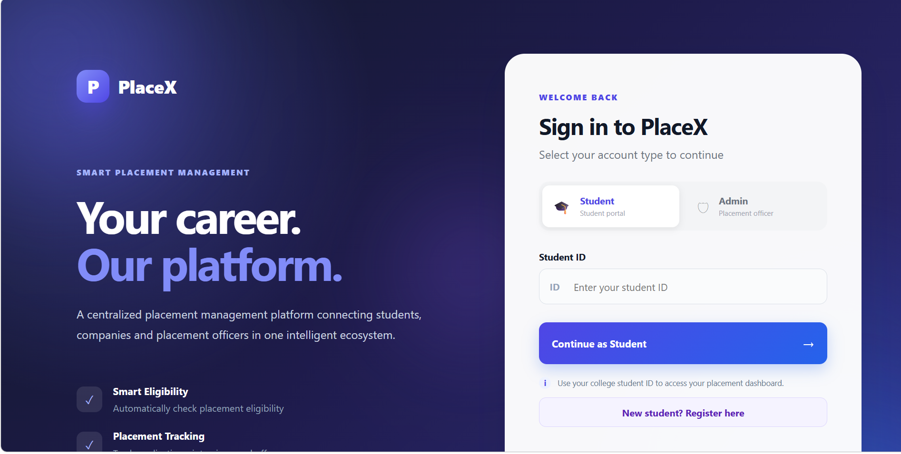
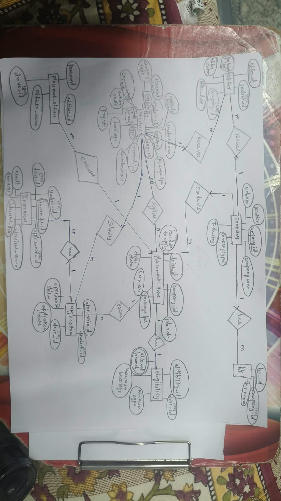
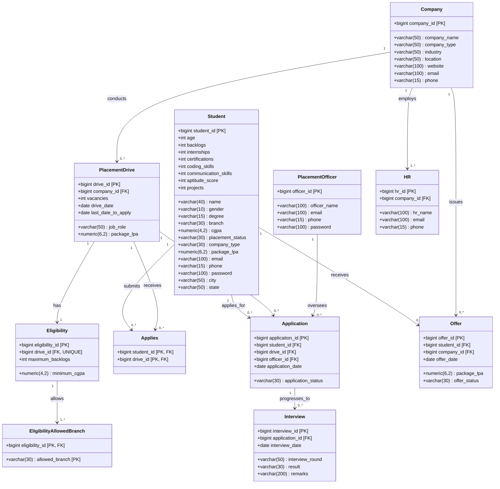
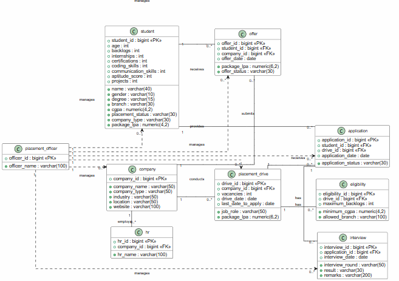
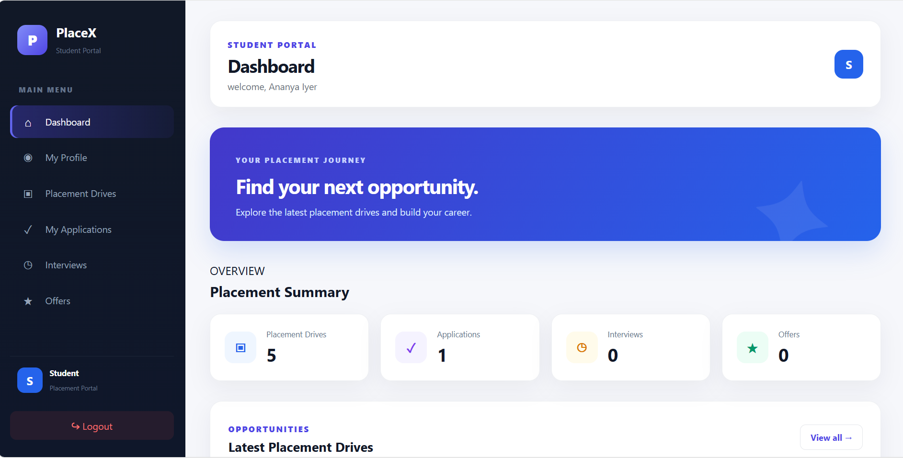
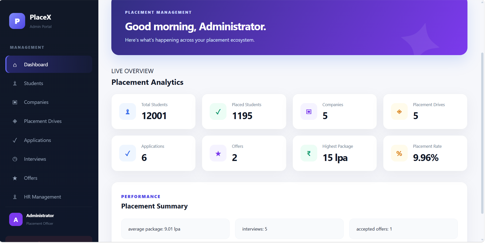

# PlaceX: College Placement Management Portal

<p align="center">
  
</p>

<p align="center">
  <strong>An Intelligent, Normalized Relational Database System and Full-Stack Web Portal for Streamlining Campus Placements</strong>
</p>

<p align="center">
  
  
  
  
  
</p>

---

## Table of Contents
1. [Project Title & Team Details](#1-project-title--team-details)
2. [Project Overview, Introduction & Problem Statement](#2-project-overview-introduction--problem-statement)
3. [System Requirements & Architecture](#3-system-requirements--architecture)
4. [ER Diagram & UML Class Diagram](#4-er-diagram--uml-class-diagram)
5. [Relational Schema Mapping & Integrity Constraints](#5-relational-schema-mapping--integrity-constraints)
6. [Normalization & Functional Dependencies (1NF → BCNF)](#6-normalization--functional-dependencies-1nf--bcnf)
7. [Methodology & Database Design](#7-methodology--database-design)
8. [Advanced SQL Queries & Analytical Operations](#8-advanced-sql-queries--analytical-operations)
9. [Installation, Setup & Execution Instructions](#9-installation-setup--execution-instructions)
10. [Demonstration Guide & Reproducing Database State](#10-demonstration-guide--reproducing-database-state)
11. [User Interface & Walkthrough](#11-user-interface--walkthrough)
12. [Repository Directory Structure](#12-repository-directory-structure)
13. [Future Enhancements & Conclusion](#13-future-enhancements--conclusion)

---

## 1. Project Title & Team Details

* **Project Title:** PlaceX: College Placement Management Portal (Smart Placement Management System)
* **Academic Course:** Database Management Systems (DBMS) — Semester 5
* **Team Identification:** **Team Number 7**

### Team Members
| S.No | Name | Roll Number | Role / Contributions |
| :---: | :--- | :--- | :--- |
| 1 | **Rupa Kandula** | `CB.SC.U4AIE24122` | Database Conceptual Modeling, ER & UML Diagram Design, BCNF Normalization Analysis |
| 2 | **Laxmi Vignesh** | `CB.SC.U4AIE24124` | Relational Schema Implementation, PostgreSQL Query Optimization, Node.js Backend & API Development |
| 3 | **Varalaxmi K S D** | `CB.SC.U4AIE24125` | Frontend Dashboard Architecture, Client-Side API Integration, Testing & Validation |

---

## 2. Project Overview, Introduction & Problem Statement

### 2.1 Introduction
In higher educational institutions, campus recruitment drives represent a pivotal milestone for students and university placement directorates. Coordinating recruitment involves hundreds of participating organizations, thousands of aspiring students across diverse engineering branches, multifaceted eligibility standards, multiple evaluation rounds (coding tests, technical interviews, HR evaluations), and offer letter distributions.

**PlaceX** is an enterprise-grade, centralized College Placement Management Portal engineered on a robust relational database foundation (PostgreSQL) coupled with a modern asynchronous Node.js/Express backend and an intuitive, responsive glassmorphism web interface.

### 2.2 Problem Statement
Traditional placement workflows predominantly depend on fragmented Google Sheets, manual record-keeping, and decentralized communication channels (emails, notice boards). This legacy paradigm suffers from critical shortcomings:
1. **Data Redundancy & Anomalies:** Redundant student profiles lead to insertion, update, and deletion anomalies across department spreadsheets.
2. **Labor-Intensive Eligibility Verification:** Placement cell staff manually cross-reference student CGPA, historical backlogs, branch rules, and skill evaluations against company cutoffs, leading to human error and missed deadlines.
3. **Lack of Lifecycle Traceability:** Students and administrators cannot track real-time application progressions through multi-tier interview rounds (applied $\rightarrow$ shortlisted $\rightarrow$ technical round $\rightarrow$ HR round $\rightarrow$ offer issued).
4. **Suboptimal Reporting & Placement Intelligence:** Placement officers struggle to aggregate real-time metrics (placement percentages, branch-wise recruitment statistics, CTC distributions, average/highest packages).

### 2.3 Proposed Solution & Core Objectives
PlaceX resolves these challenges through a unified, 3-tier database architecture that maintains absolute transactional integrity and delivers automated placement analytics:
* **Centralized Data Repository:** Consolidates students (seeded with 12,000+ realistic records), enterprise recruiters, placement officers, drives, applications, interviews, and offers into one PostgreSQL database.
* **Automated Eligibility Engine:** Dynamically validates candidate eligibility by comparing student CGPA, active backlog counts, and academic branch with company criteria stored in dedicated tables.
* **Full Lifecycle Tracking:** Provides transparent end-to-end monitoring from initial drive publication and student application to multi-stage interview scheduling and offer acceptance.
* **Role-Based Access Control:** Tailored experiences for students (profile inspection, application status, eligible drives) and placement administrators (analytics dashboard, drive coordination, company directory, student management).

---

## 3. System Requirements & Architecture

### 3.1 System Requirements
#### Software Requirements
* **Operating System:** Cross-platform (Windows 10/11, macOS, Linux)
* **Database Management System:** PostgreSQL 14.0 or higher
* **Runtime Environment:** Node.js v18.0.0+ with `npm` v9.0.0+
* **Web Browser:** Google Chrome, Mozilla Firefox, Microsoft Edge, or Safari (modern ECMAScript 6+ support)

#### Hardware Requirements
* **Processor:** 64-bit multi-core CPU (Intel Core i3/i5/i7 or AMD Ryzen equivalent)
* **Memory (RAM):** 4 GB minimum (8 GB recommended for caching 12,000+ student records)
* **Storage:** 500 MB free hard drive space (for database files, node_modules, and web assets)

### 3.2 3-Tier System Architecture
The application adheres strictly to the classic **3-Tier Client-Server Architecture**:

```
+-------------------------------------------------------------------------+
|                        1. PRESENTATION TIER                             |
|              (Responsive Web Client: HTML5, CSS3, ES6 JS)               |
|   - Student Portal: Application Submission, Drive Browsing, Offers      |
|   - Admin Dashboard: Placement KPIs, Drive Management, Interview Logs   |
+-------------------------------------------------------------------------+
                                    │
                                    │ HTTP / RESTful JSON APIs
                                    ▼
+-------------------------------------------------------------------------+
|                        2. APPLICATION / API TIER                        |
|                  (Node.js & Express.js REST Microservices)              |
|   - Controllers & Route Handlers (/api/students, /api/drives, etc.)     |
|   - Data Validation, Parameter Sanitization & Business Logic Rules      |
|   - Connection Pooling via `pg` (node-postgres)                         |
+-------------------------------------------------------------------------+
                                    │
                                    │ TCP / IP Port 5432 (SQL Protocols)
                                    ▼
+-------------------------------------------------------------------------+
|                         3. DATA STORAGE TIER                            |
|                     (PostgreSQL Relational Engine)                      |
|   - 11 Normalized BCNF Relations                                        |
|   - Primary / Foreign Key Referential Integrity & Check Constraints     |
|   - Query Processing, Aggregations, Joins & ACID Transaction Engine     |
+-------------------------------------------------------------------------+
```

---

## 4. ER Diagram & UML Class Diagram

### 4.1 Conceptual Entity-Relationship (ER) Diagram
The Entity-Relationship model establishes the real-world entities, attributes, and cardinality constraints governing the campus placement portal.

#### Primary Relationships:
* `student` **M : N** `placement_drive` (Modeled via associative relation `applies`)
* `company` **1 : M** `placement_drive` (A company conducts one or more recruitment drives)
* `placement_drive` **1 : 1** `eligibility` (Every drive has one distinct eligibility profile, enforced with a `UNIQUE` foreign key)
* `eligibility` **1 : M** `eligibility_allowed_branch` (Decomposed relation supporting multivalued branch criteria)
* `company` **1 : M** `hr` (A company employs multiple HR representatives)
* `student` **1 : M** `application` (A student submits applications across eligible drives)
* `placement_drive` **1 : M** `application` (A drive accumulates student applications)
* `placement_officer` **1 : M** `application` (Placement officers coordinate/review applications)
* `application` **1 : M** `interview` (An application traverses multiple interview stages: technical, managerial, HR)
* `student` **1 : M** `offer` (A student may receive one or multiple placement offers)
* `company` **1 : M** `offer` (A company issues job offers to successful candidates)

#### Mermaid ER Diagram
```mermaid
erDiagram
    STUDENT ||--o{ APPLIES : "submits"
    PLACEMENT_DRIVE ||--o{ APPLIES : "receives"
    COMPANY ||--o{ PLACEMENT_DRIVE : "conducts"
    PLACEMENT_DRIVE ||--|| ELIGIBILITY : "specifies"
    ELIGIBILITY ||--|{ ELIGIBILITY_ALLOWED_BRANCH : "permits"
    COMPANY ||--o{ HR : "employs"
    STUDENT ||--o{ APPLICATION : "submits"
    PLACEMENT_DRIVE ||--o{ APPLICATION : "accumulates"
    PLACEMENT_OFFICER ||--o{ APPLICATION : "coordinates"
    APPLICATION ||--o{ INTERVIEW : "schedules"
    STUDENT ||--o{ OFFER : "receives"
    COMPANY ||--o{ OFFER : "issues"

    STUDENT {
        bigint student_id PK
        varchar name
        varchar gender
        int age
        varchar degree
        varchar branch
        numeric cgpa
        int backlogs
        int internships
        int certifications
        int coding_skills
        int communication_skills
        int aptitude_score
        int projects
        varchar placement_status
        varchar company_type
        numeric package_lpa
        varchar email
        varchar phone
        varchar password
        varchar city
        varchar state
    }

    COMPANY {
        bigint company_id PK
        varchar company_name
        varchar company_type
        varchar industry
        varchar location
        varchar website
        varchar email
        varchar phone
    }

    PLACEMENT_OFFICER {
        bigint officer_id PK
        varchar officer_name
        varchar email
        varchar phone
        varchar password
    }

    PLACEMENT_DRIVE {
        bigint drive_id PK
        bigint company_id FK
        varchar job_role
        numeric package_lpa
        int vacancies
        date drive_date
        date last_date_to_apply
    }

    ELIGIBILITY {
        bigint eligibility_id PK
        bigint drive_id FK
        numeric minimum_cgpa
        int maximum_backlogs
    }

    ELIGIBILITY_ALLOWED_BRANCH {
        bigint eligibility_id PK_FK
        varchar allowed_branch PK
    }

    HR {
        bigint hr_id PK
        bigint company_id FK
        varchar hr_name
        varchar email
        varchar phone
    }

    APPLIES {
        bigint student_id PK_FK
        bigint drive_id PK_FK
    }

    APPLICATION {
        bigint application_id PK
        bigint student_id FK
        bigint drive_id FK
        bigint officer_id FK
        date application_date
        varchar application_status
    }

    INTERVIEW {
        bigint interview_id PK
        bigint application_id FK
        varchar interview_round
        date interview_date
        varchar result
        varchar remarks
    }

    OFFER {
        bigint offer_id PK
        bigint student_id FK
        bigint company_id FK
        date offer_date
        numeric package_lpa
        varchar offer_status
    }
```

<p align="center">
  <em>Figure: Hand-Drawn Conceptual ER Diagram</em><br>
  
</p>

---

### 4.2 UML Class Diagram
The UML Class Diagram illustrates class specifications, attribute typings, visibility, and structural associations between objects in the PlaceX system.



<p align="center">
  <em>Figure: Formal UML Class Diagram from Design Phase</em><br>
  
</p>

---

## 5. Relational Schema Mapping & Integrity Constraints

### 5.1 Relational Schema Definitions
The conceptual ER model is mapped to 11 normalized relational schemas:

1. **Student** ($\underline{\text{student\_id}}$, name, gender, age, degree, branch, cgpa, backlogs, internships, certifications, coding_skills, communication_skills, aptitude_score, projects, placement_status, company_type, package_lpa, email, phone, password, city, state)
2. **Company** ($\underline{\text{company\_id}}$, company_name, company_type, industry, location, website, email, phone)
3. **Placement_Officer** ($\underline{\text{officer\_id}}$, officer_name, email, phone, password)
4. **Placement_Drive** ($\underline{\text{drive\_id}}$, $\text{company\_id}^*$, job_role, package_lpa, vacancies, drive_date, last_date_to_apply)  
   *$\text{company\_id} \rightarrow \text{Company(company\_id)}$*
5. **Eligibility** ($\underline{\text{eligibility\_id}}$, $\text{drive\_id}^*$, minimum_cgpa, maximum_backlogs)  
   *$\text{drive\_id} \rightarrow \text{Placement\_Drive(drive\_id)}$ [UNIQUE]*
6. **Eligibility_Allowed_Branch** ($\underline{\text{eligibility\_id}^*, \text{allowed\_branch}}$)  
   *$\text{eligibility\_id} \rightarrow \text{Eligibility(eligibility\_id)}$*
7. **HR** ($\underline{\text{hr\_id}}$, $\text{company\_id}^*$, hr_name, email, phone)  
   *$\text{company\_id} \rightarrow \text{Company(company\_id)}$*
8. **Applies** ($\underline{\text{student\_id}^*, \text{drive\_id}^*}$)  
   *$\text{student\_id} \rightarrow \text{Student(student\_id)}$*, *$\text{drive\_id} \rightarrow \text{Placement\_Drive(drive\_id)}$*
9. **Application** ($\underline{\text{application\_id}}$, $\text{student\_id}^*$, $\text{drive\_id}^*$, $\text{officer\_id}^*$, application_date, application_status)  
   *$\text{student\_id} \rightarrow \text{Student(student\_id)}$*, *$\text{drive\_id} \rightarrow \text{Placement\_Drive(drive\_id)}$*, *$\text{officer\_id} \rightarrow \text{Placement\_Officer(officer\_id)}$*
10. **Interview** ($\underline{\text{interview\_id}}$, $\text{application\_id}^*$, interview_round, interview_date, result, remarks)  
    *$\text{application\_id} \rightarrow \text{Application(application\_id)}$*
11. **Offer** ($\underline{\text{offer\_id}}$, $\text{student\_id}^*$, $\text{company\_id}^*$, offer_date, package_lpa, offer_status)  
    *$\text{student\_id} \rightarrow \text{Student(student\_id)}$*, *$\text{company\_id} \rightarrow \text{Company(company\_id)}$*

---

### 5.2 Key & Constraint Mapping Matrix
The table below specifies every constraint enforced across the database relations:

| Constraint Type | Target Table & Columns | Operational Purpose |
| :--- | :--- | :--- |
| **PRIMARY KEY** | `student(student_id)`, `company(company_id)`, `placement_officer(officer_id)`, `placement_drive(drive_id)`, `eligibility(eligibility_id)`, `hr(hr_id)`, `application(application_id)`, `interview(interview_id)`, `offer(offer_id)` | Guarantees entity integrity and unique tuple identification. |
| **COMPOSITE PK** | `applies(student_id, drive_id)`, `eligibility_allowed_branch(eligibility_id, allowed_branch)` | Identifies unique associative mappings without artificial keys. |
| **FOREIGN KEY** | 10 distinct foreign key definitions across relations | Guarantees referential integrity; rejects orphaned child tuples. |
| **UNIQUE** | `eligibility(drive_id)` | Enforces strict 1 : 1 relationship between a drive and its criteria. |
| **CHECK** | `student.gender IN ('Male', 'Female')` | Restricts domain values to permitted enumerations. |
| **NOT NULL** | Core descriptive columns (`name`, `company_name`, `job_role`, `cgpa`, `minimum_cgpa`, `application_date`, etc.) | Eliminates null value ambiguity in critical business fields. |
| **DATA TYPES** | `BIGINT`, `NUMERIC(4,2)`, `NUMERIC(6,2)`, `DATE`, `VARCHAR` | Enforces precision on compensation, academic indices, and timestamps. |

---

## 6. Normalization & Functional Dependencies (1NF → BCNF)

### 6.1 Evolution from Initial Design (First Review $\rightarrow$ Final Schema)
During the initial design phase (Review 1), the `eligibility` relation was structured as:
$$\text{eligibility}(\underline{\text{eligibility\_id}}, \text{drive\_id}, \text{minimum\_cgpa}, \text{maximum\_backlogs}, \text{allowed\_branch})$$
where `allowed_branch` contained non-atomic comma-separated strings (e.g., `'CSE, IT, ECE'`). 

* **First Normal Form (1NF) Violation:** 1NF requires all attributes to be atomic (single-valued). Comma-delimited values violate atomicity and impede index-backed relational filtering.
* **Decomposition Solution:** Decomposed `eligibility` into:
  1. $\text{eligibility}(\underline{\text{eligibility\_id}}, \text{drive\_id}, \text{minimum\_cgpa}, \text{maximum\_backlogs})$
  2. $\text{eligibility\_allowed\_branch}(\underline{\text{eligibility\_id}, \text{allowed\_branch}})$

### 6.2 Normal Form Step-by-Step Justification
* **First Normal Form (1NF):** Every column contains atomic values, each row is unique, and domain constraints are enforced across all 11 tables.
* **Second Normal Form (2NF):** The schema is in 1NF and contains no **partial functional dependencies**—in composite key tables (`applies` and `eligibility_allowed_branch`), all non-key attributes (if any) are fully dependent on the entire composite primary key.
* **Third Normal Form (3NF):** The schema is in 2NF and exhibits no **transitive dependencies** ($X \rightarrow Y$ and $Y \rightarrow Z$ where $Z$ is a non-prime attribute). All non-prime attributes depend solely and directly on candidate keys.
* **Boyce-Codd Normal Form (BCNF):** A relation $R$ is in BCNF if and only if for every non-trivial functional dependency $X \rightarrow Y$, the determinant $X$ is a **superkey**.

### 6.3 Functional Dependency & Candidate Key Analysis
| Relation | Candidate Key(s) | Verified Functional Dependencies (FDs) | Normal Form |
| :--- | :--- | :--- | :---: |
| **student** | `student_id` | $\text{student\_id} \rightarrow \text{all other student attributes}$ | **BCNF** |
| **company** | `company_id` | $\text{company\_id} \rightarrow \text{company\_name, company\_type, industry, location, website, email, phone}$ | **BCNF** |
| **placement_officer** | `officer_id` | $\text{officer\_id} \rightarrow \text{officer\_name, email, phone, password}$ | **BCNF** |
| **placement_drive** | `drive_id` | $\text{drive\_id} \rightarrow \text{company\_id, job\_role, package\_lpa, vacancies, drive\_date, last\_date\_to\_apply}$ | **BCNF** |
| **eligibility** | `eligibility_id`, `drive_id` | $\text{eligibility\_id} \rightarrow \text{drive\_id, minimum\_cgpa, maximum\_backlogs}$<br>$\text{drive\_id} \rightarrow \text{eligibility\_id, minimum\_cgpa, maximum\_backlogs}$ (via `UNIQUE`) | **BCNF** |
| **eligibility_allowed_branch** | `(eligibility_id, allowed_branch)` | Composite key determines all attributes (all attributes are prime) | **BCNF** |
| **hr** | `hr_id` | $\text{hr\_id} \rightarrow \text{company\_id, hr\_name, email, phone}$ | **BCNF** |
| **applies** | `(student_id, drive_id)` | Composite key determines association | **BCNF** |
| **application** | `application_id` | $\text{application\_id} \rightarrow \text{student\_id, drive\_id, officer\_id, application\_date, application\_status}$ | **BCNF** |
| **interview** | `interview_id` | $\text{interview\_id} \rightarrow \text{application\_id, interview\_round, interview\_date, result, remarks}$ | **BCNF** |
| **offer** | `offer_id` | $\text{offer\_id} \rightarrow \text{student\_id, company\_id, offer_date, package_lpa, offer_status}$ | **BCNF** |

---

## 7. Methodology & Database Design

### 7.1 Engineering Methodology
The development of PlaceX followed a systematic database engineering lifecycle:
1. **Requirements Analysis:** Gathered placement business rules, user workflows (Students, Placement Officers, Recruiters), and reporting KPIs.
2. **Conceptual Modeling:** Formalized business rules into an Entity-Relationship (ER) model and UML Class representation.
3. **Logical Design & Normalization:** Translated the ER diagram into relational schemas; conducted dependency analysis and decomposed non-atomic fields into 1NF/2NF/3NF/BCNF.
4. **Physical Implementation (DDL):** Formulated PostgreSQL scripts with strict constraints (`PRIMARY KEY`, `FOREIGN KEY`, `CHECK`, `UNIQUE`, `NOT NULL`).
5. **Data Ingestion & Seeding:** Seeded enterprise tables and loaded **12,000+ realistic student records** based on academic and demographic parameters.
6. **Application Tier Development:** Built asynchronous REST endpoints using Node.js, Express, and parameterized SQL queries to prevent SQL Injection attacks.
7. **Client Presentation Tier:** Developed interactive dashboards with responsive UI components, real-time KPI aggregations, and client-side filtering.

### 7.2 Entity Cardinalities & Seed Volumes
* **student:** 12,000+ records (comprehensive diversity across CGPA, skills, backlogs, and branches)
* **company:** 5 top-tier technology & consulting firms (TCS, Infosys, Deloitte, Amazon, Wipro)
* **placement_officer:** 3 university coordinators
* **placement_drive:** 5 active recruitment campaigns
* **eligibility:** 5 drive-specific criteria sets
* **eligibility_allowed_branch:** 14 mapped allowed-branch pairings
* **hr:** 5 company talent acquisition partners
* **applies & application:** Initial sample applications spanning different progression statuses
* **interview:** Multi-round interview progression records (Technical, Managerial, HR)
* **offer:** Confirmed and pending compensation packages

---

## 8. Advanced SQL Queries & Analytical Operations

PlaceX incorporates production-ready SQL queries that demonstrate multi-table joins, subqueries, aggregations, and conditional analytics.

### 8.1 Complex Multi-Table Join: Candidate Eligibility Verification
* **Purpose:** Determines candidate eligibility by joining student academic performance against drive requirements and allowed engineering branches.

```sql
SELECT 
    s.student_id,
    s.name AS student_name,
    s.branch,
    s.cgpa,
    s.backlogs,
    c.company_name,
    pd.job_role,
    pd.package_lpa,
    e.minimum_cgpa,
    e.maximum_backlogs
FROM student s
JOIN eligibility_allowed_branch eab 
    ON s.branch = eab.allowed_branch
JOIN eligibility e 
    ON eab.eligibility_id = e.eligibility_id
JOIN placement_drive pd 
    ON e.drive_id = pd.drive_id
JOIN company c 
    ON pd.company_id = c.company_id
WHERE s.cgpa >= e.minimum_cgpa 
  AND s.backlogs <= e.maximum_backlogs
ORDER BY pd.package_lpa DESC, s.cgpa DESC;
```

---

### 8.2 End-to-End Application Tracking (4-Table JOIN)
* **Purpose:** Retrieves full application lifecycle details, uniting student identity, job role, company profile, and assigned placement officer.

```sql
SELECT 
    a.application_id,
    s.name AS student_name,
    s.branch,
    c.company_name,
    pd.job_role,
    po.officer_name AS assigned_coordinator,
    a.application_date,
    a.application_status
FROM application a
JOIN student s 
    ON a.student_id = s.student_id
JOIN placement_drive pd 
    ON a.drive_id = pd.drive_id
JOIN company c 
    ON pd.company_id = c.company_id
JOIN placement_officer po 
    ON a.officer_id = po.officer_id
ORDER BY a.application_date DESC;
```

---

### 8.3 Multi-Stage Interview Pipeline Monitoring (5-Table JOIN)
* **Purpose:** Tracks candidates through sequential interview evaluations (technical, managerial, HR) with remarks and outcomes.

```sql
SELECT 
    i.interview_id,
    s.name AS candidate_name,
    c.company_name,
    pd.job_role,
    i.interview_round,
    i.interview_date,
    i.result,
    i.remarks
FROM interview i
JOIN application a 
    ON i.application_id = a.application_id
JOIN student s 
    ON a.student_id = s.student_id
JOIN placement_drive pd 
    ON a.drive_id = pd.drive_id
JOIN company c 
    ON pd.company_id = c.company_id
ORDER BY i.interview_date DESC;
```

---

### 8.4 Placement Performance & CTC Summary Analytics
* **Purpose:** Calculates real-time placement statistics: total registered candidates, placed count, placement rate %, average package, and maximum package.

```sql
SELECT 
    COUNT(student_id) AS total_students,
    COUNT(CASE WHEN LOWER(placement_status) = 'placed' THEN 1 END) AS placed_students,
    ROUND(
        (COUNT(CASE WHEN LOWER(placement_status) = 'placed' THEN 1 END)::numeric / 
        COUNT(student_id)::numeric) * 100, 
        2
    ) AS placement_percentage,
    ROUND(AVG(CASE WHEN package_lpa > 0 THEN package_lpa END), 2) AS average_package_lpa,
    MAX(package_lpa) AS highest_package_lpa
FROM student;
```

---

### 8.5 Branch-Wise Placement CTC Distribution (Group By & Having)
* **Purpose:** Provides institutional insights into placement volume and average CTC categorized by engineering branch.

```sql
SELECT 
    branch,
    COUNT(student_id) AS total_candidates,
    COUNT(CASE WHEN LOWER(placement_status) = 'placed' THEN 1 END) AS placed_candidates,
    ROUND(AVG(CASE WHEN package_lpa > 0 THEN package_lpa END), 2) AS avg_branch_package,
    MAX(package_lpa) AS max_branch_package
FROM student
GROUP BY branch
HAVING COUNT(student_id) > 10
ORDER BY avg_branch_package DESC NULLS LAST;
```

---

## 9. Installation, Setup & Execution Instructions

Follow these step-by-step instructions to clone, configure, and launch the portal locally.

### 9.1 Prerequisites
Ensure the following are installed and added to your system PATH:
* [PostgreSQL](https://www.postgresql.org/download/) (v14 or higher)
* [Node.js](https://nodejs.org/) (v18 or higher with `npm`)
* [Git](https://git-scm.com/)

---

### 9.2 Clone the Repository
```bash
git clone https://github.com/K-LAXMIVIGNESH/Collage-Placement-Portal.git
cd Collage-Placement-Portal
```

---

### 9.3 Database Setup in PostgreSQL
1. Open terminal / command prompt or `psql`:
```bash
# Connect to PostgreSQL CLI
psql -U postgres
```

2. Create the `placex` database:
```sql
CREATE DATABASE placex;
\c placex
```

3. Execute the schema creation and data population script:
```bash
# Execute directly from repository
psql -U postgres -d placex -f database/schema.sql
```
*(Alternatively, copy and run the contents of [`database/schema.sql`](database/schema.sql) in pgAdmin Query Tool).*

---

### 9.4 Configure Environment Variables
Inside the `backend/` directory, create or edit the configuration file `demo.env` (or copy from `backend/.env.example`):

```bash
cd backend
```

Create/update `demo.env`:
```env
db_host=localhost
db_port=5432
db_name=placex
db_user=postgres
db_password=your_postgres_password
```

---

### 9.5 Install Dependencies & Launch Application
From within the `backend/` folder, run:

```bash
# Install required npm packages (express, pg, dotenv)
npm install

# Start the Node.js server
npm start
```

You should observe the following terminal confirmation:
```
postgresql database connected
server is running on port 3000
```

---

### 9.6 Access the Web Application
Open your web browser and navigate to:
```
http://localhost:3000
```

---

## 10. Demonstration Guide & Reproducing Database State

To reproduce and verify the exact database and application state presented in reviews:

### Step 1: Database Seed Verification
Run the verification queries in `psql` or pgAdmin:
```sql
SELECT 'student' AS table_name, COUNT(*) FROM student
UNION ALL
SELECT 'company', COUNT(*) FROM company
UNION ALL
SELECT 'placement_drive', COUNT(*) FROM placement_drive
UNION ALL
SELECT 'eligibility', COUNT(*) FROM eligibility
UNION ALL
SELECT 'eligibility_allowed_branch', COUNT(*) FROM eligibility_allowed_branch
UNION ALL
SELECT 'hr', COUNT(*) FROM hr
UNION ALL
SELECT 'application', COUNT(*) FROM application
UNION ALL
SELECT 'interview', COUNT(*) FROM interview
UNION ALL
SELECT 'offer', COUNT(*) FROM offer;
```

---

### Step 2: Student Portal Demonstration
1. Open `http://localhost:3000`.
2. On the **Sign in to PlaceX** page, click the **Student** tab.
3. Input any valid student ID (e.g., `1`, `2`, or `5`) and click **Continue as Student**.
4. **Student Dashboard:**
   * View personalized student profile (Name, Branch, CGPA, Backlogs, Skills).
   * Navigate to **Placement Drives** to view active recruitment campaigns with package details.
   * Navigate to **My Applications** to verify submitted applications and eligibility.
   * Inspect **Interviews** and **Offers** for real-time interview rounds and offer status.

---

### Step 3: Admin / Placement Officer Demonstration
1. On the login screen, select the **Admin** tab.
2. Sign in as a placement officer (e.g., Officer ID: `801`, `802`, or `803`).
3. **Live Placement Analytics:**
   * Review high-level KPIs: **Total Students (12,001)**, **Placed Students (1,195)**, **Companies (5)**, **Drives (5)**, **Highest Package (15 LPA)**, and **Placement Rate (9.96%)**.
4. **Management Tabs:**
   * **Students:** Browse, search, and inspect individual student profiles and skills.
   * **Companies:** View recruiter corporate offices, websites, and HR contacts.
   * **Placement Drives:** Track vacancies, drive dates, and application cutoffs.
   * **Applications:** Review submitted student applications with real-time status updates.
   * **Interviews:** Inspect technical/HR rounds, scores, and committee remarks.
   * **Offers:** Monitor issued packages, acceptance rates, and pending confirmations.

---

## 11. User Interface & Walkthrough

<p align="center">
  <strong>1. Smart Placement Portal Authentication</strong><br>
  <em>Clean, responsive login interface supporting role-based entry for Students and University Officers.</em><br><br>
  
</p>

<br>

<p align="center">
  <strong>2. Student Portal Dashboard</strong><br>
  <em>Personalized candidate command center featuring drive listings, application progress, and interview notifications.</em><br><br>
  
</p>

<br>

<p align="center">
  <strong>3. Placement Officer Live Analytics Dashboard</strong><br>
  <em>Administrator dashboard displaying institutional KPIs, placement ratios, package distributions, and management tables.</em><br><br>
  
</p>

---

## 12. Repository Directory Structure

```
Collage-Placement-Portal/
├── assets/                                 # Visual artifacts and documentation assets
│   ├── admin-dashboard.png                 # Admin dashboard KPI screenshot
│   ├── er-diagram-handdrawn.png            # Original hand-drawn ER diagram from PPT
│   ├── login-ui.png                        # Portal sign-in interface screenshot
│   ├── student-dashboard.png               # Student command center screenshot
│   └── uml-diagram.png                     # Formal UML class diagram from PPT
│
├── backend/                                # Application and API Layer
│   ├── node_modules/                       # Node dependencies (git-ignored)
│   ├── .env.example                        # Template for database credentials
│   ├── demo.env                            # Active environment configuration
│   ├── package.json                        # Node dependencies and scripts
│   ├── package-lock.json                   # Deterministic dependency lockfile
│   └── server.js                           # Express REST API & PostgreSQL pool connection
│
├── database/                               # Database Tier
│   └── schema.sql                          # Complete DDL, constraints & seed scripts
│
├── frontend/                               # Presentation Tier
│   ├── index.html                          # Single-page application markup
│   ├── script.js                           # Client-side routing, API fetch & DOM binding
│   └── style.css                           # Modern glassmorphism UI styles
│
├── .gitignore                              # Git exclusion rules (node_modules, .env)
├── package-lock.json                       # Root lockfile
└── README.md                               # Comprehensive project documentation
```

---

## 13. Future Enhancements & Conclusion

### 13.1 Future Enhancements
* **Automated Eligibility Filter on Application Submission:** Implement backend database triggers to restrict students from applying to drives for which their CGPA, backlogs, or branch do not qualify.
* **Full Administrative CRUD Modals:** Enable placement officers to add, update, and archive recruitment drives, job roles, and candidate statuses directly from the UI.
* **Resume Parsing & Skill-Matching Engine:** Incorporate automated CV ingestion to cross-match candidate technical proficiencies with recruiter requirements.
* **Automated Notification Engine:** Real-time email and SMS alerts for shortlisting results, interview round schedules, and offer letter generation.
* **Role-Based JWT Authentication:** Transition from identifier-based lookup to encrypted JSON Web Token (JWT) sessions and bcrypt password hashing.

### 13.2 Conclusion
The **PlaceX College Placement Management Portal** provides a dependable, scalable solution to the challenges of manual campus placement administration. Grounded in formal relational database principles—with strict primary/foreign key constraints, domain assertions, and full BCNF normalization—PlaceX eliminates data redundancy, preserves referential integrity, and provides real-time placement visibility. Integrated with an Express.js REST API and a modern web dashboard, PlaceX serves as an exemplary full-stack DBMS engineering project.

---

<p align="center">
  <strong>PlaceX — Smart Placement Management System</strong><br>
  Developed by Team 7 • Semester 5 DBMS Project
</p>